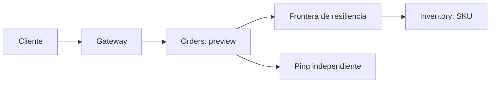
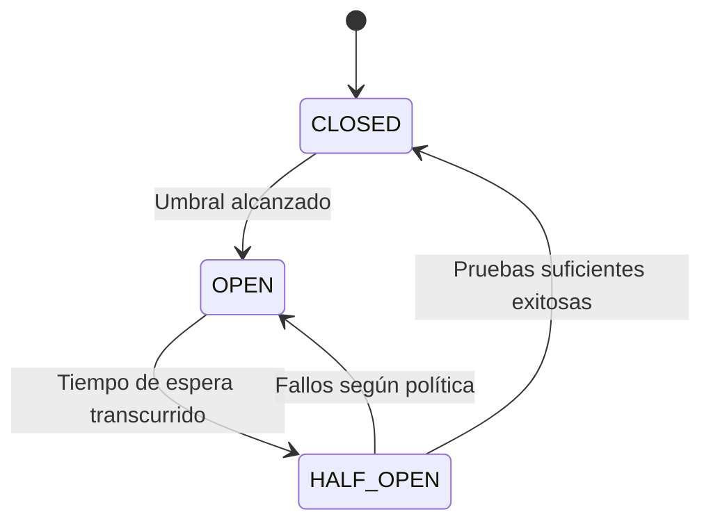

# P02 — Advanced Orders Platform: diseñar resiliencia ante fallos
**CORE · O2.** Prerrequisito: comprender la comunicación HTTP de P01. El checkpoint P02 incluye P01 resuelto, pero las cuatro políticas de resiliencia están incompletas. Conserva tu trabajo anterior en tu rama. No necesitas Azure, Kafka ni la Parte 2.

## 1. La situación de negocio
Una campaña comercial aumenta las consultas de disponibilidad de pedidos. Inventory tiene una incidencia: unas veces responde lentamente, otras devuelve un error temporal y, en momentos de máxima demanda, no puede atender todas las solicitudes. Orders depende de Inventory para decidir si un pedido es atendible. Un fallo de esa dependencia no debe convertir una simple consulta en una espera indefinida ni arrastrar funcionalidades independientes.

El equipo de arquitectura solicita una política explícita para la llamada Orders → Inventory. No se admite devolver que hay stock cuando no lo sabemos. Tampoco se permite reintentar indiscriminadamente ni ocultar errores. El objetivo es aprender a **diseñar, implementar y justificar** los mecanismos, no copiar una configuración de producción.

### Objetivos
Al finalizar podrás configurar plazos de conexión/respuesta, clasificar excepciones para Retry, implementar la integración de Circuit Breaker y Bulkhead con Resilience4j, medir el efecto de cada patrón y justificar su composición. Diferenciarás una solicitud lógica de los intentos de red que produce.


El Gateway enruta. Orders decide la política de dependencia; Inventory conoce stock. En CORE protegemos el cliente HTTP de Inventory, no todas las llamadas de la plataforma. Shipping no se necesita para P02. El catálogo sigue siendo simulado, sin reservas ni pagos.

### Mapa del código
| Ruta relativa | Responsabilidad |
|---|---|
| `services/orders/src/main/java/com/advancedorders/orders/config/HttpClientConfig.java` | TODO P02.1: fábrica HTTP y timeouts |
| `services/orders/src/main/java/com/advancedorders/orders/client/InventoryClient.java` | getInventory delega en resilience.execute; fetch realiza la llamada y envuelve excepciones |
| `services/orders/src/main/java/com/advancedorders/orders/client/InventoryResilience.java` | TODO P02.2–4: configuración, clasificación y decoradores |
| `services/orders/src/main/java/com/advancedorders/orders/api/ApiExceptionHandler.java` | Traducción de errores a HTTP ya preparada |
| `services/orders/src/main/java/com/advancedorders/orders/api/ResilienceTrainingController.java` | Métricas y ping didácticos |
| `services/orders/src/test/java/com/advancedorders/orders/client/InventoryResilienceExercise.java` | Pruebas de aceptación Java |
| `docker-compose.yml` | Variables de configuración e inyección de fallos |
| `labs/p02-resilience/burst.py` | Ocho consultas concurrentes y ping |
| `scripts/verify-p02.sh` | Aceptación de integración por patrón |

El starter compila y responde normalmente. Los objetos de Resilience4j se crean con defaults para permitir diagnósticos, pero no protegen la llamada hasta que completes los TODOs. No implementes algoritmos internos de la librería; sí diseña e integra sus políticas.

### Línea base y contrato de fallo
```bash
make down
make up
make verify
URL='http://127.0.0.1:8080/api/orders/preview?sku=SKU-001&quantity=2'
STATS='http://127.0.0.1:8080/api/orders/training/resilience'
curl -sS --max-time 12 -w '\nHTTP %{http_code} tiempo %{time_total}s\n' "$URL"
curl -fsS "$STATS"
make p02-test
```
Espera HTTP 200, stock 42, canBeFulfilled=true. Algunos tests del ejercicio deben fallar por políticas no implementadas; no por compilación. `make test` sigue siendo regresión normal. Registra en [EVIDENCE](EVIDENCE.md) los resultados. Los contadores son por proceso Orders; recrearlo los reinicia. Una llamada a preview incrementa attempts cuando llega a fetch; consultar STATS no aumenta attempts.

| Situación | Respuesta externa esperada |
|---|---|
| Consulta atendible | 200, canBeFulfilled=true |
| Stock insuficiente | 200, canBeFulfilled=false (no es fallo de infraestructura) |
| Dependencia falla/timeout | 502 INVENTORY_UNAVAILABLE |
| Circuito abierto | 503 CIRCUIT_OPEN, sin llamada de red |
| Capacidad del Bulkhead agotada | 503 BULKHEAD_FULL, sin llamada de red |

SKU desconocido devuelve 404 en Inventory y se traduce a 502 en Orders según el contrato existente del simulador. Es un error no reintentable; no confundas el status externo con la causa interna. Antes de programar, dibuja la frontera y propone un presupuesto máximo orientativo de 1,5 s para la consulta. No afirmes que ya está garantizado.

## 2. Timeout: limitar la espera
**Problema.** Una consulta normalmente rápida tarda ahora dos segundos. Una espera prolongada ocupa recursos de Orders mientras se aguarda la respuesta. Inyecta demora con la configuración de laboratorio:
```bash
TRAINING_INVENTORY_DELAY_MS=2000 docker compose up -d --wait --force-recreate --no-deps inventory
curl -sS --max-time 12 -w '\nHTTP %{http_code} tiempo %{time_total}s\n' "$URL"
```
Resultado esperado: 200 y demora cercana a 2 s más overhead. El healthcheck puede seguir UP porque no consulta el SKU demorado.

**Diseña.** Distingue timeout de establecimiento de conexión de timeout de respuesta/lectura. Decide qué resultado debe recibir el cliente si Inventory no responde a tiempo. No inventar disponibilidad.

**Implementa P02.1.** En HttpClientConfig.inventoryRestClient, usa las propiedades connectMs/readMs ya inyectadas. Construye un java.net.http.HttpClient con connectTimeout(Duration.ofMillis(connectMs)); crea JdkClientHttpRequestFactory, configura setReadTimeout con readMs y proporciona requestFactory al builder de RestClient. Conserva la URL base de Inventory. Consulta SUPPORT si necesitas una pista. No cambiar el controlador ni modificar Inventory para simular el timeout del cliente.
```bash
P02_READ_MS=500 docker compose up -d --build --wait --no-deps orders
curl -sS --max-time 12 -w '\nHTTP %{http_code} tiempo %{time_total}s\n' "$URL"
curl -fsS "$STATS"
```
Espera 502 INVENTORY_UNAVAILABLE, un intento y tiempo próximo a 500 ms más overhead. La demora no desaparece necesariamente en Inventory: la operación remota puede continuar. La espera de respuesta y el connect timeout no equivalen a un deadline global; curl --max-time es un límite del cliente de prueba, no la política de Orders.

**Evidencia:** comparación antes/después, HTTP, duración y attempts. Explica por qué un timeout no demuestra que la operación remota no ocurrió.

## 3. Retry: repetir solo cuando tiene sentido
**Problema.** Inventory devuelve un 503 temporal. Repetir una consulta de lectura podría permitir recuperarse, pero reintentar todo aumenta carga y tiempo de respuesta. Activa el fallo reproducible (la demora vuelve a cero) y prueba antes de implementar:
```bash
TRAINING_INVENTORY_FAIL=true docker compose up -d --wait --force-recreate --no-deps inventory
docker compose up -d --wait --force-recreate --no-deps orders
curl -sS -w '\nHTTP %{http_code}\n' "$URL"
curl -fsS "$STATS"
```
**Diseña.** Política didáctica: máximo tres intentos incluyendo el inicial; espera fija 100 ms; reintentar ResourceAccessException (fallo de acceso al transporte) y HTTP 502/503/504 cuando estén envueltos en InventoryUnavailableException. No reintentar 404, 500 ni otras causas. No es una regla universal para todas las APIs; depende de semántica e idempotencia. En producción considerar backoff/jitter y presupuesto global.

**Implementa P02.2.** En InventoryResilience:
1. Sustituye Retry.ofDefaults por Retry.of con RetryConfig.custom, usando maxAttempts, retryWait y el predicado isTransient.
2. Completa isTransient: revisa el tipo de excepción y su causa; discrimina los tres status concretos. No clasifiques una excepción como transitoria solo porque Orders responde 502.
3. En execute, decora Supplier con Retry si retryEnabled. El Supplier contiene el trabajo pendiente; no lo ejecutes al construir la política.
```bash
P02_RETRY=true docker compose up -d --build --wait --no-deps orders
curl -sS -w '\nHTTP %{http_code} tiempo %{time_total}s\n' "$URL"
curl -fsS "$STATS"
curl -sS -w '\nHTTP %{http_code}\n' 'http://127.0.0.1:8080/api/orders/preview?sku=SKU-999&quantity=2'
curl -fsS "$STATS"
```
Con Inventory en fallo, espera 502 y attempts=3 tras la primera consulta; el SKU desconocido suma solo 1 (total 4). Revisa logs: `docker compose logs --tail=80 orders inventory`. El test selectedHttpErrorsOnly comprueba 500 (un intento) y 503 (tres) mediante una excepción simulada.
```bash
mvn -B -pl services/orders -am -Dtest=InventoryResilienceExercise#retryCountsInitialAttemptAndRetries+selectedHttpErrorsOnly -Dsurefire.failIfNoSpecifiedTests=false test
```
Las pruebas de Circuit Breaker aún pueden fallar si ejecutas make p02-test completo. Para cerrar el concepto, explica por qué tres intentos no son tres reintentos, y por qué una operación no idempotente necesita garantías adicionales antes de repetirla.

## 4. Circuit Breaker: dejar de insistir
**Problema.** Inventory sigue averiado. Cada nueva consulta crea nuevos intentos. Necesitamos dejar de llamar temporalmente a una dependencia que está fallando repetidamente y permitir su recuperación.

**Diseña.** Ventana de 4 llamadas, mínimo 4, umbral de fallo 50%, espera abierta configurable (15 s en experimento), 2 llamadas permitidas en half-open. Ignora causas no transitorias en las métricas del circuito. Estado por instancia Orders, no compartido entre réplicas.

**Implementa P02.3.** Configura CircuitBreakerConfig.custom y CircuitBreaker.of en constructor, sustituyendo defaults. Usa slidingWindowSize, minimumNumberOfCalls, failureRateThreshold, waitDurationInOpenState, permittedNumberOfCallsInHalfOpenState e ignoreException con la política anterior. Añade decorador condicionado por circuitEnabled. Mantén los event publishers.
```bash
P02_CIRCUIT=true P02_OPEN_MS=15000 docker compose up -d --build --wait --no-deps orders
for i in 1 2 3 4 5; do
  curl -sS --max-time 12 -w '\nHTTP %{http_code}\n' "$URL"
done
curl -fsS "$STATS"
```
Solo CB activo: cuatro respuestas 502, quinta 503 CIRCUIT_OPEN. attempts=4, circuitState=OPEN, notPermittedCalls aumenta. No se ejecuta fetch para el rechazo. Restaura Inventory **sin recrear Orders**:
```bash
docker compose up -d --wait --force-recreate --no-deps inventory
sleep 16
curl -sS -w '\nHTTP %{http_code}\n' "$URL"
curl -sS -w '\nHTTP %{http_code}\n' "$URL"
curl -fsS "$STATS"
make p02-test
```
Dos 200 y estado CLOSED, tras el periodo abierto. La transición puede producirse al llegar una llamada, no necesariamente por un temporizador activo. Si tarda más por recreación o propagación, consulta logs. Nunca reinicies Orders para fingir recuperación: borrarías el estado. Registra las transiciones y explica cómo una ventana de 4 difiere de un contador de errores consecutivos.

## 5. Bulkhead: limitar el impacto de la concurrencia
**Problema.** Inventory vuelve a funcionar, pero responde lentamente. Ocho consultas simultáneas pueden ocupar recursos de Orders. Queremos limitar cuántas operaciones de esa dependencia se admiten a la vez, sin confundir límite de concurrencia con límite de peticiones por segundo.

**Diseña.** Bulkhead de semáforo: máximo 2 operaciones concurrentes, espera cero. Cuando no hay permiso, rechazar con BULKHEAD_FULL. El ping independiente permite observar si una operación no dependiente de Inventory sigue respondiendo; no demuestra aislamiento total de CPU, memoria o threads.

**Implementa P02.4.** Construye BulkheadConfig.custom con maxConcurrentCalls(maxConcurrent), maxWaitDuration(Duration.ZERO). Sustituye Bulkhead.ofDefaults y añade el decorador si bulkheadEnabled. Inyecta demora, compara sin y con protección:
```bash
TRAINING_INVENTORY_DELAY_MS=2000 docker compose up -d --wait --force-recreate --no-deps inventory
docker compose up -d --wait --force-recreate --no-deps orders
python3 labs/p02-resilience/burst.py
curl -fsS "$STATS"
P02_BULKHEAD=true P02_MAX_CONCURRENT=2 docker compose up -d --build --wait --no-deps orders
python3 labs/p02-resilience/burst.py --assert-bulkhead
curl -fsS "$STATS"
```
El script inicia ocho peticiones concurrentes mediante una barrera y consulta ping durante la ráfaga. Con protección se esperan al menos un 200 y un 503, los 503 con BULKHEAD_FULL. No exigir exactamente 2 éxitos y 6 rechazos: depende de planificación y timing. Compara attempts y tiempos; los rechazos no consumen intento remoto. Registra si el ping responde en ambos casos y qué no demuestra esa observación.

## 6. Composición: decidir el orden y el presupuesto
**Problema.** Cada patrón funciona por separado. ¿Qué pasa cuando todos intervienen? Diseña una cadena en la que el circuito cuente intentos reales y el Bulkhead limite la operación lógica completa. Decide qué decorador se crea primero (más interno), qué sucede durante espera de Retry y qué excepciones no deben reintentarse.


Este es el objetivo de referencia para CORE; debes implementarlo y explicar el orden, no copiar solo un diagrama. El último decorador aplicado es el más externo. Compara temporalmente la alternativa con CB por fuera de Retry: predice cuántas llamadas registra el circuito cuando una operación tiene tres intentos fallidos. Haz un test propio con Supplier que siempre lanza la excepción transitoria del ejercicio; compara attempts y bufferedCalls en ambos órdenes. Restaura la composición elegida.
```bash
TRAINING_INVENTORY_FAIL=true docker compose up -d --wait --force-recreate --no-deps inventory
P02_RETRY=true P02_CIRCUIT=true P02_BULKHEAD=true P02_OPEN_MS=15000 docker compose up -d --build --wait --no-deps orders
for i in 1 2 3; do curl -sS -w '\nHTTP %{http_code}\n' "$URL"; done
curl -fsS "$STATS"
```
Con CB interno y cuatro fallos, el circuito puede abrir durante una operación lógica; los rechazos del circuito no se reintentan. Explica la diferencia frente a CB externo (cuenta operaciones lógicas). No atribuyas la misma métrica a ambas composiciones.

**Presupuesto.** Tres intentos de 500 ms y dos esperas de 100 ms ya suman 1700 ms, sin conexión ni overhead. Propón una política compatible con el objetivo 1,5 s y qué margen reservarías. Un cálculo orientativo no es un deadline absoluto: incluye conexión, procesamiento y colas; considera timeout global/cancelación explícita como extensión.

**Aceptación y recuperación.**
```bash
make p02-test
docker compose build orders
make p02-verify
make up
make verify
```
El verificador usa las imágenes existentes: reconstruye Orders después de cambiar Java. Ejecuta timeout, retry, circuito y bulkhead por separado; detiene el entorno al acabar (también si falla). Si pasa, espera P02 integration smoke passed; make up recupera baseline sin fallos. No sustituye tu prueba de composición ni demuestra garantías de producción.

**Entrega:** diagrama, diff Java, prueba propia, tabla de evidencias, ADR breve con política y alternativa descartada. Guarda tu commit; el siguiente checkpoint P03 contiene P02 resuelto y el starter Kafka. No publiques referencias privadas.
[SUPPORT](SUPPORT.md) · [STRETCH](STRETCH.md) · [EVIDENCE](EVIDENCE.md)
