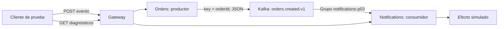
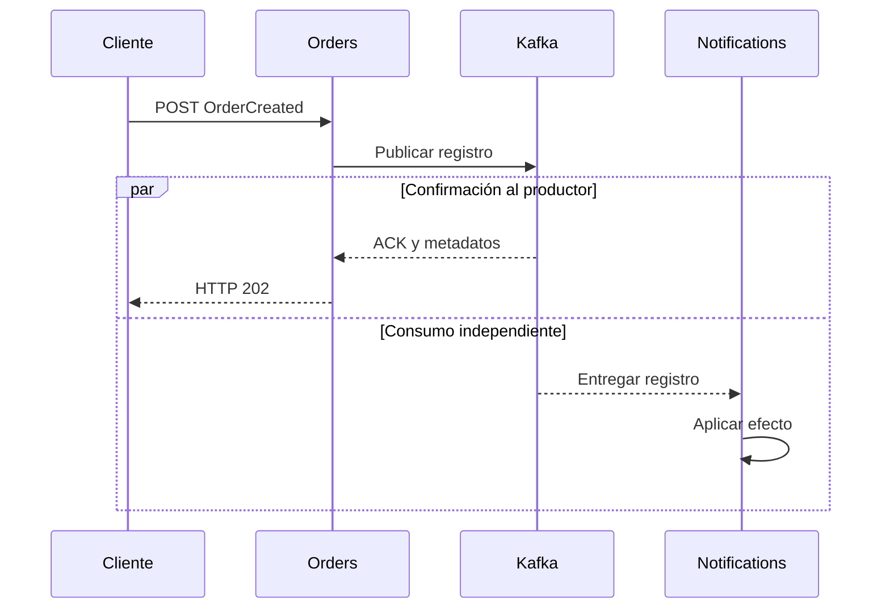

# P03 — Advanced Orders Platform: diseñar e implementar comunicación asíncrona
**CORE · O3.** Prerrequisito: comprender la comunicación REST y las políticas de fallo de P01/P02. El checkpoint incluye P02 resuelto y deja el productor y el consumidor Kafka incompletos. Guarda el trabajo de la práctica anterior en su propia rama. No requiere Azure ni Parte 2.

## 1. Contexto, arquitectura y contrato
El equipo de producto quiere avisar a los clientes cuando se crea un pedido. Si Orders llama directamente a Notifications mediante HTTP, su operación depende de que ese servicio esté disponible en ese instante. Una caída de Notifications puede ralentizar o interrumpir un flujo de negocio que no debería esperar al envío de un aviso.

El equipo propone publicar un evento **OrderCreated** y permitir que Notifications lo procese de forma asíncrona. Tu misión es diseñar y programar los dos extremos de la comunicación y demostrar qué sucede si el consumidor está detenido o recibe el mismo evento lógico más de una vez.

**Límite de este laboratorio:** el endpoint de entrenamiento publica un evento simulado. No crea ni persiste un pedido real, no envía correos, no implementa aún Outbox y no garantiza atomicidad entre una transacción de Orders y Kafka. P04 introducirá la persistencia de eventos de dominio. Kafka aquí es un broker de integración, no nuestro Event Store.



### Diseña el contrato
El contrato JSON del ejercicio ya está representado como record OrderCreated en ambos servicios. Identifica qué campos representan identidad del hecho, identidad del agregado y datos del evento:
| Campo | Ejemplo | Semántica |
|---|---|---|
| eventId | evt-001 | Identidad lógica del evento para deduplicación |
| orderId | order-01 | Identidad del pedido y key de Kafka |
| sku | SKU-001 | Producto del pedido simulado |
| quantity | 2 | Cantidad positiva |

`orders.created.v1` tiene 3 particiones, factor de replicación 1 (un solo broker KRaft). Dos publicaciones con la misma key se esperan en la misma partición en esta configuración; el offset identifica una posición en esa partición, no globalmente. Dos eventos con el mismo eventId pueden ocupar offsets distintos. Define qué debe hacer el consumidor ante duplicados y qué significa una respuesta 202.


El ACK confirma aceptación por el broker según configuración, no que Notifications haya procesado el evento. El consumidor incluso puede procesarlo antes de que el cliente reciba el 202. Con RF1, acks=all no implica tolerancia a pérdida del broker.

### Mapa de archivos
| Ruta | Responsabilidad |
|---|---|
| `services/orders/src/main/java/com/advancedorders/orders/events/OrderEventPublisher.java` | TODO productor, validación y respuesta HTTP |
| `services/notifications/src/main/java/com/advancedorders/notifications/events/OrderEventConsumer.java` | TODO listener, tratamiento y deduplicación |
| `services/notifications/src/main/java/com/advancedorders/notifications/events/EventDiagnosticsController.java` | Consulta de contadores por eventId |
| `services/orders/pom.xml`, `services/notifications/pom.xml` | Spring Kafka |
| `compose.kafka.yml` | Broker, serializers, grupo/ack y configuración de servicios |
| `scripts/p03-up.sh` | Inicializar volumen, broker, topic y servicios |
| `scripts/verify-p03.sh` | Aceptación HTTP y asíncrona |

### Arranca el entorno
```bash
make down
make p03-up
C=(docker compose -f docker-compose.yml -f compose.kafka.yml --profile extended)
"${C[@]}" ps
"${C[@]}" exec -T kafka /opt/kafka/bin/kafka-topics.sh --bootstrap-server localhost:9092 --describe --topic orders.created.v1
make verify
BASE=http://127.0.0.1:8080/api
ID="p03-$(date +%s)-$$"
BODY="{\"eventId\":\"$ID\",\"orderId\":\"order-01\",\"sku\":\"SKU-001\",\"quantity\":2}"
curl -i --max-time 20 -X POST "$BASE/orders/training/events" -H 'Content-Type: application/json' -d "$BODY"
```
Espera broker saludable y topic con 3 particiones. El POST válido devuelve 501 porque el productor está pendiente. Esto no es un error de Kafka. El baseline REST debe seguir funcionando. Kafka solo es accesible dentro de Compose. Si usas una nueva terminal, vuelve a declarar C, BASE e IDs.

## 2. Implementa el productor en Orders
**Problema:** convertir la petición de entrenamiento en un registro de Kafka y devolver evidencia verificable de su publicación.

Abre OrderEventPublisher. Ya existen @RestController, @PostMapping, validación de campos, constantes y dependencias inyectadas. Completa publish:
1. Serializa el record con el ObjectMapper del stack (tools.jackson.databind).
2. Usa KafkaTemplate<String,String>.send con topic, key orderId y JSON; conserva el futuro devuelto.
3. Espera el resultado con un plazo acotado de 12 segundos y extrae partition/offset del RecordMetadata.
4. Devuelve ResponseEntity 202 con eventId, topic, partition, offset y status BROKER_ACKNOWLEDGED.
5. Si se interrumpe el hilo, restaura su marca de interrupción; traduce fallo de publicación/espera a 503. No inventes offset ni afirmes que el evento no llegó al broker: el resultado puede ser incierto.

La configuración ya establece acks=all, producer idempotence, límites de entrega y serialización String. No implementes el protocolo Kafka ni bloquees indefinidamente. El futuro es una operación asíncrona, pero nuestro adaptador HTTP espera la confirmación para poder devolver metadatos; esto no vuelve síncrono el consumo de Notifications.

```bash
"${C[@]}" up -d --build --wait --no-deps orders
curl -i --max-time 20 -X POST "$BASE/orders/training/events" -H 'Content-Type: application/json' -d "$BODY"
curl -fsS "$BASE/notifications/training/events/$ID"
```
Espera 202 con metadatos reales del broker; partition entre 0 y 2, offset no negativo. El consumidor aún no tiene listener, por lo que sus contadores deben estar a cero. Guarda el eventId y los metadatos. No supongas que el offset es cero si el topic ya contiene registros. Prueba un body con quantity=0 y comprueba 400.

**Reflexión:** ¿qué diferencia existe entre el ACK del productor y la confirmación de un efecto de negocio? ¿Qué ocurriría si el cliente HTTP pierde el 202 y reenvía la petición?

## 3. Implementa el consumidor e idempotencia
**Problema:** los registros pueden entregarse más de una vez y el productor puede publicar de nuevo un evento lógico. Notifications debe recibirlos sin repetir el efecto simulado.

Abre OrderEventConsumer. Los mapas concurrentes, ObjectMapper y snapshot están preparados. Completa el método consume:
- Declara @KafkaListener con topic orders.created.v1 y groupId notifications-p03.
- Deserializa record.value() a OrderCreated. Usa eventId como identidad lógica, no offset ni orderId.
- Incrementa received por cada entrega y registra key, partition, offset y eventId en logs.
- En una primera versión, incrementa effects por cada entrega. Reconstruye, espera el consumo y observa el problema de duplicados antes de corregirlo.

```bash
"${C[@]}" up -d --build --wait --no-deps notifications
curl -fsS "$BASE/notifications/training/events/$ID"
DUP="p03-dup-$(date +%s)-$$"
DUP_BODY="{\"eventId\":\"$DUP\",\"orderId\":\"order-01\",\"sku\":\"SKU-001\",\"quantity\":2}"
for i in 1 2; do
  curl -fsS --max-time 20 -X POST "$BASE/orders/training/events" -H 'Content-Type: application/json' -d "$DUP_BODY"
  echo
done
curl -fsS "$BASE/notifications/training/events/$DUP"
"${C[@]}" logs --tail=80 notifications
```
La lectura de diagnóstico puede adelantarse al consumo: repite GET hasta observar received=2 (no vuelvas a publicar durante esa espera). Primera versión: effects=2. El grupo con earliest lee registros retenidos cuando no existe offset válido; los offsets ya confirmados no se vuelven a leer solo por reiniciar. Los mapas de diagnóstico son memoria del proceso y se reinician al recrear Notifications.

**Corrige.** Utiliza una operación atómica de mapa para aplicar como máximo un efecto simulado por eventId, sin perder el contador de entregas. No basta con consultar containsKey y después actualizar en operaciones separadas. Explica por qué producer idempotence no deduplica dos invocaciones deliberadas de send. Reconstruye Notifications y usa un **eventId nuevo**:
```bash
"${C[@]}" up -d --build --wait --no-deps notifications
DUP="p03-fixed-$(date +%s)-$$"
DUP_BODY="{\"eventId\":\"$DUP\",\"orderId\":\"order-01\",\"sku\":\"SKU-001\",\"quantity\":2}"
for i in 1 2; do
  curl -fsS --max-time 20 -X POST "$BASE/orders/training/events" -H 'Content-Type: application/json' -d "$DUP_BODY"
  echo
done
curl -fsS "$BASE/notifications/training/events/$DUP"
```
Repite GET hasta received=2/effects=1. La deduplicación es solo en memoria y el efecto es un contador; no simula una transacción con un proveedor de correo. No prometas exactamente una entrega ni exactly-once de un efecto externo.

### Prueba propia
Crea `services/notifications/src/test/java/com/advancedorders/notifications/events/OrderEventConsumerTest.java`. Instancia el consumidor con ObjectMapper, prepara un JSON válido y dos ConsumerRecord de mismo eventId/key y distintos offsets; invoca consume dos veces, consulta snapshot y verifica received=2/effects=1. Usa JUnit y AssertJ como en otras pruebas del repositorio. No necesitas broker para esta prueba unitaria.
```bash
mvn -B -pl services/notifications -am -Dtest=OrderEventConsumerTest -Dsurefire.failIfNoSpecifiedTests=false test
```
No confirmes offset manualmente en el listener: el contenedor está configurado con AckMode.RECORD y auto-commit=false. La prueba unitaria verifica lógica local; la integración prueba broker y wiring.

## 4. Prueba indisponibilidad y recuperación
Notifications cae mientras Orders continúa publicando. Predice qué ocurre con el ACK, el lag y el efecto. Detén solo Notifications, publica un ID nuevo y arráncalo de nuevo:
```bash
"${C[@]}" stop notifications
OFF="p03-offline-$(date +%s)-$$"
OFF_BODY="{\"eventId\":\"$OFF\",\"orderId\":\"order-01\",\"sku\":\"SKU-001\",\"quantity\":2}"
curl -i --max-time 20 -X POST "$BASE/orders/training/events" -H 'Content-Type: application/json' -d "$OFF_BODY"
"${C[@]}" exec -T kafka /opt/kafka/bin/kafka-consumer-groups.sh --bootstrap-server localhost:9092 --describe --group notifications-p03
"${C[@]}" up -d --wait notifications
curl -fsS "$BASE/notifications/training/events/$OFF"
```
Espera 202 aun con consumidor detenido, si Kafka está disponible. El lag puede aumentar; su representación depende del grupo y sus offsets. Tras arrancar, espera received=1/effects=1 para ese ID. No republiques por impaciencia.

Ejecuta aceptación final, con ambos servicios reconstruidos:
```bash
make p03-verify
"${C[@]}" exec -T kafka /opt/kafka/bin/kafka-consumer-groups.sh --bootstrap-server localhost:9092 --describe --group notifications-p03
make p03-down
```
El verificador crea IDs nuevos, exige dos publicaciones con misma key/partición y offsets crecientes, dos entregas/un efecto, y recuperación offline. Espera P03 broker, duplicate and offline recovery smoke passed. El down conserva el volumen Kafka. No borrar volúmenes para forzar un resultado.

**Debrief y entrega.** Diagrama, contrato, diff de productor/consumidor, test propio, metadatos, contadores y resultado offline. Explica:
- ACK, offset confirmado y efecto externo son cosas distintas.
- Qué garantía falta si Notifications reinicia después de ejecutar un efecto pero antes de confirmar offset.
- Por qué Kafka no es automáticamente Event Sourcing.
- Cuándo elegir un log particionado y grupos (Kafka) o routing por exchanges y colas (RabbitMQ clásico; RabbitMQ también dispone de streams).

Completa [EVIDENCE](EVIDENCE.md). En P04 modelaremos eventos de dominio persistidos, proyecciones y Saga, un problema distinto de entregar mensajes.

[SUPPORT](SUPPORT.md) · [STRETCH](STRETCH.md)
