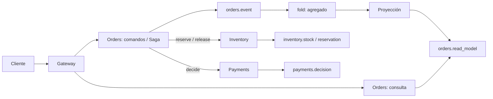
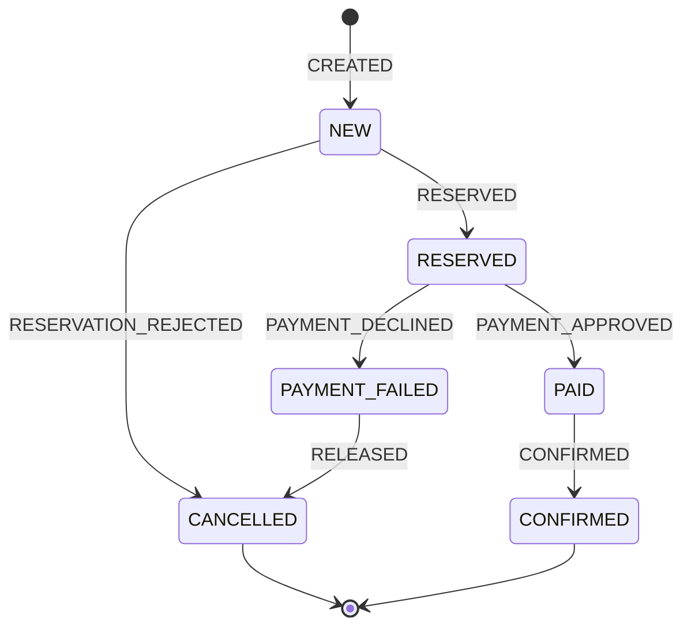
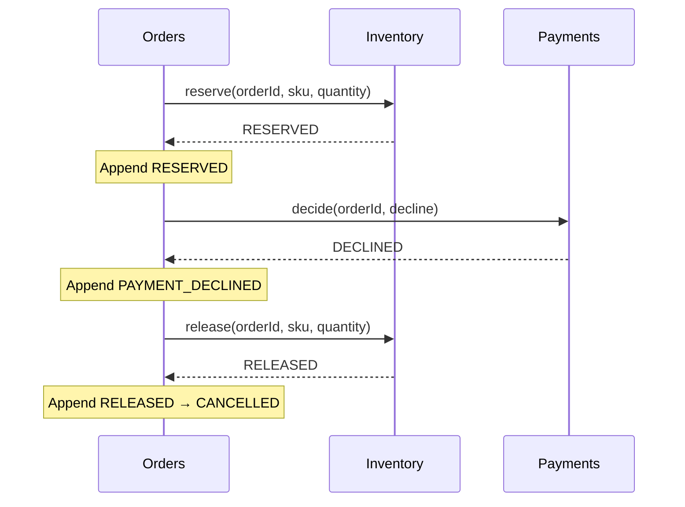

# P04 — Advanced Orders Platform: diseñar e implementar Event Sourcing, CQRS y Saga
**CORE · O4.** Prerrequisito: P01–P03 y conceptos de transacción local. Este checkpoint incluye P03 resuelto, PostgreSQL, esquema, persistencia JDBC y participantes de Saga preparados. El alumno implementa las tres piezas centrales: reconstrucción del agregado, proyección y coordinación/compensación. No necesita Azure ni un Kafka activo.

## 1. Contexto y modelado
Hasta ahora una consulta de Orders solo comprobaba disponibilidad y P03 publicaba un evento simulado. Ahora producto quiere **crear un pedido persistente**, reservar stock, solicitar una decisión de pago y confirmar o cancelar el pedido. La reserva de Inventory y la decisión de Payments son operaciones que pueden tener éxito o fallar independientemente. Una transacción de Orders no puede hacer rollback de una operación HTTP confirmada en otro servicio.

El equipo solicita además un historial auditable del pedido, una consulta rápida de estado y un mecanismo de compensación. Necesita responder: ¿qué ocurrió?, ¿cuál es el estado reconstruido?, ¿qué puede ver el usuario? y ¿qué pasa si el pago se rechaza después de reservar stock?

Tu misión es diseñar e implementar tres patrones conectados, distinguiendo sus responsabilidades:
- **Event Sourcing:** persistir hechos y reconstruir estado de un pedido a partir del historial ordenado.
- **CQRS:** separar el modelo de escritura del modelo de lectura; construir una proyección de consulta.
- **Saga:** coordinar transacciones locales y compensar una reserva cuando se rechaza el pago.

No son sinónimos ni deben aplicarse siempre juntos. En una aplicación CRUD sencilla puede bastar un modelo de estado actual y transacciones locales. Este ejercicio combina los tres para aprender sus interacciones.

### Arquitectura y límites del simulador

PostgreSQL aloja tres esquemas lógicamente separados, pero hay una instancia y credenciales de entrenamiento compartidas. No equivale a aislamiento físico de bases de datos, ni a una arquitectura productiva segura. Orders llama a los participantes por HTTP, no actualiza directamente sus tablas. La proyección se activa manualmente; no hay consumidor Kafka, scheduler, Outbox ni transacción distribuida global. Un orquestador por proceso, synchronized y las transacciones JDBC locales son simplificaciones deliberadas; no garantizan coordinación correcta entre múltiples réplicas.

### Mapa de archivos
| Archivo | Qué existe / qué debes construir |
|---|---|
| `services/orders/src/main/java/com/advancedorders/orders/state/OrderStateController.java` | Records Command/Event/State, history, append, create, query, helpers HTTP y persistencia preparados. TODO fold, project, advance |
| `services/inventory/src/main/java/com/advancedorders/inventory/state/InventoryStateController.java` | Reserva, liberación y stock persistente; idempotencia por orderId y payload |
| `services/payments/src/main/java/com/advancedorders/payments/state/PaymentStateController.java` | Decisión de pago simulada, estable por orderId |
| `services/orders/src/test/java/com/advancedorders/orders/state/OrderStateExercise.java` | Cuatro pruebas de reconstrucción y validación |
| `labs/p04-state/schema.sql` | Esquemas, tablas, restricciones y catálogo persistente inicial |
| `compose.state.yml`, `scripts/p04-up.sh` | PostgreSQL y servicios de estado |
| `scripts/verify-p04.sh` | Aceptación integrada de historial, lectura, compensación y éxito |

### Modelo del agregado
El identificador del pedido es orderId. Command representa una intención; Event un hecho registrado; State el estado derivado. El comando inicial contiene orderId, sku, quantity y decline (flag didáctico para simular rechazo de pago). El historial usa versiones consecutivas desde 1. El estado no se almacena como una fila autoritativa adicional de Orders: se reconstruye desde los eventos. No uses read_model para decidir transiciones.


Especifica invariantes: un único CREATED inicial; versiones consecutivas; sku, quantity y decline estables; transiciones válidas; no registrar compensación sin confirmación de Inventory; estado terminal no añade evento. Distingue el rechazo inicial de reserva de la liberación tras pago rechazado. No hay reserva que compensar si Inventory rechaza la solicitud.

Arranca el entorno:
```bash
make p03-down
make down
make p04-up
C=(docker compose -f docker-compose.yml -f compose.state.yml --profile extended)
"${C[@]}" ps
make verify
make p04-test
```
El baseline REST debe pasar. Las pruebas P04 deben fallar por fold pendiente, no por compilación. El catálogo inicial del esquema es 42/7/0 unidades de SKU-001/002/003, si el volumen es nuevo. Consulta el stock actual antes de experimentar; no supongas 42 después de ensayos previos. El verificador necesita al menos dos unidades disponibles. El volumen persiste al detener el entorno.

## 2. Event Sourcing: implementar reconstrucción del agregado
**Problema:** un historial persistido no sirve para decidir el siguiente paso si no sabemos reconstruir y validar el agregado.

Lee history: SELECT ordenado por version. Lee append: INSERT con version anterior + 1. Lee create: transacción local, fila stream, bloqueo SELECT FOR UPDATE y primer evento CREATED. La clave primaria (order_id,version) impide duplicar una versión, pero no comprueba por sí sola la secuencia válida del dominio.

**Implementa P04.1:** completa el método estático fold(String id,List<Event> events) en OrderStateController. Es una función pura: misma entrada, misma salida, sin SQL, HTTP, reloj ni efectos externos. El historial vacío ya produce 404. Recorre eventos en orden; exige versión esperada comenzando en 1, CREATED como primer evento y transiciones según el diagrama. Rechaza versiones ausentes, duplicadas, eventos desconocidos, datos de creación inconsistentes o transición imposible con IllegalStateException. Construye State con id, datos del primer evento, estado final y última versión. No ordenes ni "repares" silenciosamente un historial corrupto.

```bash
make p04-test
```
Los tests comprueban historial cancelado, exitoso, transición inválida y hueco de versiones. Añade uno propio: evento después de terminal o sku alterado en una versión posterior. No cambies las pruebas existentes. Nota: el test de historial exitoso usa una lista sintética con decline=true; fold valida hechos y transición, no vuelve a ejecutar la decisión de pago a partir del flag didáctico.

Reconstruye Orders y prueba la API:
```bash
"${C[@]}" up -d --build --wait --no-deps orders
BASE=http://127.0.0.1:8080/api
OS="$BASE/orders/training/state"
IS="$BASE/inventory/training/state"
ID="p04-fail-$(date +%s)-$$"
BODY="{\"orderId\":\"$ID\",\"sku\":\"SKU-001\",\"quantity\":2,\"decline\":true}"
curl -fsS -X POST "$OS/commands" -H 'Content-Type: application/json' -d "$BODY"
curl -fsS "$OS/$ID/events"
curl -fsS "$OS/$ID/aggregate"
curl -fsS -X POST "$OS/commands" -H 'Content-Type: application/json' -d "$BODY"
curl -fsS "$OS/$ID/events"
```
Espera NEW v1 y un solo CREATED incluso después de repetir el comando idéntico. Comprueba el conflicto de payload:
```bash
curl -i -X POST "$OS/commands" -H 'Content-Type: application/json' -d "{\"orderId\":\"$ID\",\"sku\":\"SKU-001\",\"quantity\":3,\"decline\":true}"
```
Espera 409 y el historial original intacto. Distingue idempotencia del comando de la deduplicación de mensajes P03. Guarda ID y versión para la fase siguiente.

## 3. CQRS: implementar el modelo de lectura
**Problema:** reconstruir toda la historia cada vez que se consulta el estado puede ser costoso. El equipo quiere una proyección que responda consultas sin modificar el historial.

Antes de implementar:
```bash
curl -i "$OS/$ID/query"
curl -i -X POST "$OS/$ID/project"
```
query devuelve 404 porque la proyección no existe. project todavía falla por TODO. El agregado sí existe y está NEW v1. No es un pedido perdido: son dos representaciones con ciclos de actualización distintos.

**Implementa P04.2:** completa project. Lee State mediante aggregate(id), mapea orderId/sku/quantity/status/version a orders.read_model, ejecuta un UPSERT parametrizado con PreparedStatement. Inserta si no existe; actualiza si la versión entrante es más reciente (condición WHERE en ON CONFLICT DO UPDATE). Usa try-with-resources y devuelve query(id) tras persistir. No ejecutar operaciones de negocio durante la proyección; no copiar decline al modelo de lectura porque el contrato de consulta no lo necesita.

```bash
"${C[@]}" up -d --build --wait --no-deps orders
curl -fsS -X POST "$OS/$ID/project"
curl -fsS "$OS/$ID/query"
curl -fsS "$OS/$ID/events"
```
Espera NEW v1 en query; historial no cambia. Repetir project no crea eventos ni modifica el stock. La actualización manual permite observar inconsistencia temporal de forma controlada; no hay convergencia automática sin un mecanismo que ejecute project.

## 4. Saga: implementar coordinación y compensación
**Problema:** reservar stock y decidir pago son operaciones de otros servicios. Si el pago falla tras una reserva, Orders debe solicitar una compensación explícita, no ejecutar rollback de una transacción que ya fue confirmada.


Las llamadas reserve, decidePayment y release están preparadas. recordTransition registra un evento en transacción local de Orders después de la respuesta remota. Lee los helpers y los participantes. Inventory hace reserva/liberación en transacción local, con un registro por orderId y verificación de payload; Payments devuelve una decisión estable. No hagas SQL sobre tablas de otro servicio desde Orders.

**Implementa P04.3:** completa advance para decidir una transición por llamada, partiendo de aggregate, no de query. Mapa de decisión:
| Estado actual | Acción | Respuesta confirmada | Evento |
|---|---|---|---|
| NEW | reserve | RESERVED / REJECTED | RESERVED / RESERVATION_REJECTED |
| RESERVED | decidePayment | APPROVED / DECLINED | PAYMENT_APPROVED / PAYMENT_DECLINED |
| PAID | Confirmar localmente | — | CONFIRMED |
| PAYMENT_FAILED | release | RELEASED | RELEASED |
| CONFIRMED / CANCELLED | Ninguna | — | Ninguno |

Si una llamada falla o devuelve una respuesta no prevista, no registres un éxito inventado. El estado anterior debe permanecer hasta poder confirmar/reconciliar. El helper recordTransition no debe ejecutarse antes del efecto remoto. No mantener una transacción SQL abierta durante HTTP. En el caso terminal devuelve el estado actual, sin append.

### Caso A: pago rechazado y compensación
```bash
"${C[@]}" up -d --build --wait --no-deps orders
curl -fsS "$IS/stock/SKU-001"
curl -fsS -X POST "$OS/$ID/advance"
curl -fsS "$IS/stock/SKU-001"
curl -fsS "$OS/$ID/query"
curl -fsS "$OS/$ID/aggregate"
curl -fsS -X POST "$OS/$ID/advance"
curl -fsS -X POST "$OS/$ID/advance"
curl -fsS "$IS/stock/SKU-001"
curl -fsS "$OS/$ID/events"
```
Esperado: RESERVED v2 y stock inicial menos 2; query sigue NEW v1 hasta proyectar; PAYMENT_FAILED v3; CANCELLED v4 y stock inicial restaurado. Registra stock relativo, no asumas 42. Repite advance y release con mismo ID:
```bash
curl -fsS -X POST "$OS/$ID/advance"
curl -fsS -X POST "$IS/release" -H 'Content-Type: application/json' -d "{\"orderId\":\"$ID\",\"sku\":\"SKU-001\",\"quantity\":2}"
curl -fsS "$IS/stock/SKU-001"
curl -fsS -X POST "$OS/$ID/project"
```
No se añade un quinto evento, release devuelve RELEASED sin incrementar de nuevo, proyección CANCELLED v4.

### Caso B: camino exitoso
```bash
OK="p04-ok-$(date +%s)-$$"
curl -fsS -X POST "$OS/commands" -H 'Content-Type: application/json' -d "{\"orderId\":\"$OK\",\"sku\":\"SKU-001\",\"quantity\":2,\"decline\":false}"
for i in 1 2 3; do curl -fsS -X POST "$OS/$OK/advance"; echo; done
curl -fsS -X POST "$OS/$OK/project"
curl -fsS "$IS/stock/SKU-001"
```
RESERVED, PAID, CONFIRMED v4; stock disminuye dos unidades. No hay pago real. Si queda poco stock, usa sandbox limpio según SUPPORT después de guardar evidencias. Caso complementario: SKU-003 tiene 0 unidades inicialmente; una reserva rechazada produce CANCELLED v2, sin pago ni liberación. Comprueba el historial y justifica.

## 5. Replay, recuperación y aceptación
### Reconstruye la proyección y verifica persistencia
```bash
curl -fsS "$OS/$ID/query"
curl -fsS -X DELETE "$OS/$ID/projection"
curl -i "$OS/$ID/query"
curl -fsS -X POST "$OS/$ID/project"
"${C[@]}" restart orders
"${C[@]}" up -d --wait --no-deps orders
curl -fsS "$OS/$ID/aggregate"
curl -fsS "$OS/$ID/query"
```
Espera 404 al borrar solo proyección, CANCELLED v4 al reconstruir y el mismo estado tras reiniciar Orders. No borres el Event Store. Comprueba que replay no reserva ni libera stock otra vez.

### Ventana de fallo: efecto remoto confirmado, evento todavía no registrado
Simula el caso en que Orders envía una reserva, Inventory confirma, pero Orders se detiene antes de registrar RESERVED. No se trata de provocar una caída exacta del proceso: invocamos el participante directamente para reproducir el estado intermedio.
```bash
REC="p04-recovery-$(date +%s)-$$"
curl -fsS -X POST "$OS/commands" -H 'Content-Type: application/json' -d "{\"orderId\":\"$REC\",\"sku\":\"SKU-001\",\"quantity\":2,\"decline\":true}"
curl -fsS "$IS/stock/SKU-001"
curl -fsS -X POST "$IS/reserve" -H 'Content-Type: application/json' -d "{\"orderId\":\"$REC\",\"sku\":\"SKU-001\",\"quantity\":2}"
curl -fsS "$OS/$REC/aggregate"
curl -fsS "$IS/stock/SKU-001"
curl -fsS -X POST "$OS/$REC/advance"
curl -fsS "$IS/stock/SKU-001"
for i in 1 2; do curl -fsS -X POST "$OS/$REC/advance"; echo; done
curl -fsS "$IS/stock/SKU-001"
```
Antes de advance, Orders sigue NEW aunque Inventory reservó. Tras advance, Inventory reconoce el mismo orderId/payload: stock no disminuye otra vez; Orders registra RESERVED. Completa pago rechazado y compensación para devolver stock. Explica por qué esta idempotencia ayuda en la ventana de fallo y qué garantías faltan para coordinación HA.

### Aceptación
```bash
make p04-test
"${C[@]}" up -d --build --wait --no-deps orders
make p04-verify
make p04-down
```
Espera P04 event history, stale read, replay, compensation and success passed. El verificador crea IDs nuevos y consume dos unidades en su camino exitoso. No restablece stock al final. Conserva el volumen al detener; un reset de sandbox es una decisión explícita.

**Entrega:** modelo de estados y secuencia, diff de fold/project/advance, prueba propia, historial y versiones, proyección atrasada y reconstruida, stock antes/después de compensación y recuperación, y ADR: ¿cuándo elegirías CQRS/Event Sourcing/Saga frente a CRUD y transacciones locales? Completa [EVIDENCE](EVIDENCE.md). Guarda tu trabajo en commit propio. El siguiente checkpoint P05 contiene P04 resuelto e integraciones incompletas.

[SUPPORT](SUPPORT.md) · [STRETCH](STRETCH.md)
