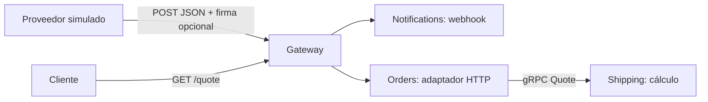

# P05 — Advanced Orders Platform: diseñar e implementar Webhooks y gRPC
**CORE · O5.** Prerrequisito: P01–P04 y comunicación HTTP. El checkpoint incluye P04 resuelto y los esqueletos de las integraciones. No requiere Azure, Kafka ni PostgreSQL activo.

## 1. Contexto y arquitectura
El equipo logístico quiere informar a nuestra plataforma cuando un pedido se entrega. El proveedor externo enviará una notificación HTTP a Notifications. Un reintento tras perder la respuesta no debe producir un segundo efecto de negocio. Al mismo tiempo, Orders quiere consultar Shipping mediante un contrato RPC tipado, con una fecha límite para la respuesta.

Tu misión es diseñar ambos contratos, implementar el receptor webhook, completar el contrato Protobuf y construir el cliente y servidor gRPC. No hay proveedor real, envío de correo ni pago real. Shipping utiliza el mismo cálculo simulado que REST; Notifications mantiene contadores en memoria. El adaptador HTTP de Orders permite probar el RPC con curl; curl no habla gRPC en esta prueba.



### Contrato webhook
POST /api/notifications/training/webhooks/delivery. JSON: eventId (1..64 caracteres alfanuméricos o guion), type=shipping.delivered, orderId no vacío. El eventId identifica el hecho; el orderId identifica el pedido. Una entrega válida devuelve 200 con eventId, received y effects. Dos entregas del mismo hecho cuentan 2/1. JSON o contrato inválido: 400, sin efecto. Firma inválida si se configura secreto: 401. Límite didáctico de body: 8192 bytes (413); se comprueba después de recibir bytes, no sustituye límites de infraestructura.

### Contrato RPC
ShippingQuotes.Quote, unary request/reply. QuoteRequest conserva destination (string=1) y weight_grams (int32=2). Completa QuoteReply sin renumerar los campos existentes:
| Campo | Tipo | Número |
|---|---|---|
| destination | string | 1 |
| weight_grams | int32 | 2 |
| price_cents | int64 | 3 |
| currency | string | 4 |
| estimated_days | int32 | 5 |
| provider | string | 6 |

Para ES/500 g, precio esperado 499 céntimos EUR; consulta Shipping, no codifiques el importe en Orders. Un contrato protobuf describe la estructura de los mensajes y la operación, no todas las reglas de negocio. Dibuja ambos flujos y explica quién inicia cada interacción.

### Archivos
| Ruta | Responsabilidad |
|---|---|
| `services/notifications/src/main/java/com/advancedorders/notifications/webhook/WebhookController.java` | TODO receptor; firma, límite y contadores preparados |
| `services/orders/src/main/proto/shipping.proto` y `services/shipping/src/main/proto/shipping.proto` | TODO campos de respuesta; ambos deben coincidir |
| `services/shipping/src/main/java/com/advancedorders/shipping/rpc/ShippingRpcServer.java` | TODO método Quote; ciclo de vida del servidor preparado |
| `services/shipping/src/main/java/com/advancedorders/shipping/domain/ShippingPricing.java` | Regla de negocio compartida con REST |
| `services/orders/src/main/java/com/advancedorders/orders/rpc/ShippingRpcController.java` | TODO cliente RPC y traducción de estados |
| `compose.integrations.yml`, `scripts/verify-p05.sh` | Entorno y aceptación |

```bash
make p04-down
make p03-down
make p05-up
C=(docker compose -f docker-compose.yml -f compose.integrations.yml --profile extended)
BASE=http://127.0.0.1:8080/api
HOOK="$BASE/notifications/training/webhooks/delivery"
RPC="$BASE/orders/training/grpc/quote"
ID="hook-$(date +%s)-$$"
BODY="{\"eventId\":\"$ID\",\"type\":\"shipping.delivered\",\"orderId\":\"order-01\"}"
make verify
curl -i -X POST "$HOOK" -H 'Content-Type: application/json' -d "$BODY"
curl -i "$RPC"
```
Baseline REST verde. Webhook y adaptador RPC devuelven 501 por TODO; el servidor RPC devuelve UNIMPLEMENTED si se invoca directamente. No es un fallo de instalación.

## 2. Implementa el receptor webhook
Lee delivery y stats. El body llega como byte[] para poder verificar la firma sobre los bytes originales. La comprobación de tamaño y firma ya existe. Completa:
1. Deserializa raw en Event con ObjectMapper (tools.jackson.databind). Convierte JSON inválido a 400.
2. Valida eventId, type y orderId antes de incrementar contadores.
3. Cuenta cada entrega válida; aplica un único efecto simulado por eventId mediante operación atómica del mapa concurrente. Devuelve stats.
4. Añade una prueba propia: dos entregas válidas del mismo evento y un JSON o contrato inválido. Usa JUnit; el constructor acepta ObjectMapper y secreto vacío para el caso sin firma. Verifica que el inválido no crea efecto. No cambies la validación HMAC preparada.

```bash
"${C[@]}" up -d --build --wait --no-deps notifications
for i in 1 2; do
  curl -fsS -X POST "$HOOK" -H 'Content-Type: application/json' -d "$BODY"
  echo
done
curl -fsS "$BASE/notifications/training/webhooks/$ID"
curl -i -X POST "$HOOK" -H 'Content-Type: application/json' -d '{"eventId":"invalid","type":"wrong","orderId":"order-01"}'
curl -i -X POST "$HOOK" -H 'Content-Type: application/json' -d '{'
```
Espera received=2/effects=1 y 400 en ambos inválidos. Si reconstruyes/recreas Notifications, usa IDs nuevos para comparar. La memoria no sobrevive a reinicios y no proporciona exactly-once de efectos reales. Explica qué ocurre si el proveedor pierde el HTTP 200 y reenvía el mismo body.

## 3. Diseña Protobuf e implementa el servidor
Edita ambos shipping.proto con los campos acordados. Genera código:
```bash
cmp services/orders/src/main/proto/shipping.proto services/shipping/src/main/proto/shipping.proto
mvn -B -pl services/orders,services/shipping -am generate-sources
```
Inspecciona target/generated-sources; localiza QuoteRequest, QuoteReply y ShippingQuotesGrpc. No edites código generado. El servidor hereda ShippingQuotesImplBase y el cliente usa un blocking stub. En una arquitectura real ambos consumirían un contrato versionado de origen común; aquí dos copias permiten trabajar sin otro repositorio.

Completa quote en ShippingRpcServer. Reutiliza ShippingPricing.quote para validar destino/peso y calcular; construye QuoteReply con builder, envía onNext y onCompleted. Traduce IllegalArgumentException a INVALID_ARGUMENT con onError. Usa la demora simulada delayMs y comprueba Context.current().isCancelled() antes de emitir la respuesta. Si Thread.sleep se interrumpe, restaura la marca y termina con estado de cancelación cuando corresponda. No devolver éxito tras un error ni llamar onCompleted después de onError. La demora es un experimento, no una implementación de producción.

## 4. Implementa cliente RPC y deadline
Completa ShippingRpcController.quote. El ManagedChannel y stub ya están creados; el canal usa shipping:9090 sin TLS en la red privada del laboratorio. Valida deadlineMs (50..5000, ya preparado). Construye QuoteRequest con destination/weightGrams, invoca stub.withDeadlineAfter(deadlineMs, TimeUnit.MILLISECONDS).quote(request), construye la respuesta JSON a partir del reply.

| Resultado gRPC | HTTP adaptador |
|---|---|
| OK | 200, grpcCode OK y datos de cotización |
| INVALID_ARGUMENT | 400 |
| DEADLINE_EXCEEDED | 504 |
| UNAVAILABLE | 503 |
| Otros errores | 502 |

Captura StatusRuntimeException y usa getStatus().getCode(); no inventes cotización si falla. Deadline acota la espera RPC, no prueba rollback de un efecto remoto. No cambiar REST ni exponer 9090.

```bash
make p05-up
curl -fsS "$BASE/shipping/quote?destination=ES&weightGrams=500"
curl -fsS "$RPC?destination=ES&weightGrams=500&deadlineMs=3000"
curl -i "$RPC?weightGrams=-1&deadlineMs=3000"
P05_GRPC_DELAY_MS=1500 "${C[@]}" up -d --wait --force-recreate --no-deps shipping
curl -i "$RPC?deadlineMs=3000"
curl -i "$RPC?deadlineMs=300"
"${C[@]}" up -d --wait --force-recreate --no-deps shipping
curl -i "$RPC?deadlineMs=3000"
```
REST y RPC deben devolver 499; peso inválido 400 INVALID_ARGUMENT; demora con deadline 3000 permite 200 y con 300 produce 504 DEADLINE_EXCEEDED. Tras recrear Shipping puede haber UNAVAILABLE transitorio: espera reconexión y confirma un 200 con plazo amplio antes de probar el corto. No confundir un timeout de curl con un 504 del adaptador. Registra valores observados.

## 5. Aceptación y cierre
```bash
make test
make p05-verify
make p05-down
```
El verificador usa las imágenes ya construidas (si cambiaste Java, make p05-up primero). Comprueba duplicado, precio REST/RPC, argumento inválido, deadline, recuperación y firma HMAC: activa un secreto ficticio, rechaza entrega sin firma, acepta firma válida y restaura configuración. Requiere openssl en Codespace. Espera P05 webhook, gRPC quote, deadline, recovery and HMAC passed.

Entrega contrato, diagramas, diff de las tres piezas Java y los dos proto, prueba propia y resultados. Justifica REST vs gRPC vs webhook para cada flujo; distingue firma/autenticidad, deduplicación y protección frente a replay (no implementada). Completa [EVIDENCE](EVIDENCE.md). No publicar puertos ni usar secretos reales.

[SUPPORT](SUPPORT.md) · [STRETCH](STRETCH.md)
