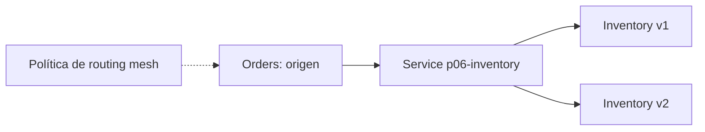
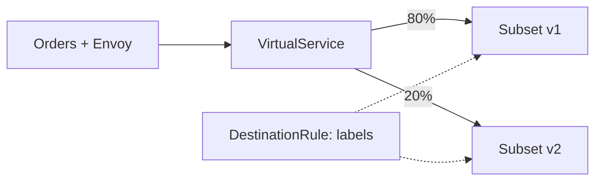

# P06 — Advanced Orders Platform: diseñar balanceo y políticas de Service Mesh
**CORE · O6.** Prerrequisito: conocer servicios, contenedores y comunicación HTTP de P00–P05. Checkpoint independiente. No se necesita Gateway público, Kafka ni PostgreSQL.

## 1. Contexto y decisiones arquitectónicas
El equipo quiere desplegar una nueva versión de Inventory sin enviarle todo el tráfico de golpe. Kubernetes permite ejecutar varias réplicas y descubrirlas mediante un Service, pero el equipo necesita controlar qué versión recibe una petición, probar una versión candidata y poder revertir una política de tráfico sin reescribir Java. En este ejercicio v1 y v2 ejecutan la misma lógica: solo cambia la metadata APP_VERSION. Es un simulador de routing, no una release con cambios funcionales reales.

Tu misión es diseñar un Service para dos versiones, implementar enrutamiento ponderado con Istio y comparar la política con Linkerd mediante Gateway API. Distingue tres elementos: selección de endpoints por etiquetas, distribución de conexiones y enrutamiento L7. Un Service de tipo LoadBalancer solicita integración de entrada del proveedor; no es automáticamente un proxy HTTP que entienda versiones. No se creará LoadBalancer público ni se modificará la configuración global de ningún cluster.



### Archivos de trabajo
| Archivo | Qué vas a hacer |
|---|---|
| `labs/p06-mesh/workloads.yaml` | Deployment de Orders y dos Inventory; imágenes renderizadas |
| `labs/p06-mesh/service.yaml` | TODO selector común a ambas versiones |
| `labs/p06-mesh/istio.yaml` | TODO labels de subsets y pesos de VirtualService |
| `labs/p06-mesh/version-services.yaml` | Services por versión para Linkerd |
| `labs/p06-mesh/linkerd-route.yaml` | TODO pesos de HTTPRoute |
| `scripts/p06-render.sh` | Sustituye referencias de imagen |
| `scripts/p06-sample.sh` | Peticiones nuevas desde contenedor Orders; conteo por versión y Pod |
| `scripts/p06-linkerd-prepare.sh` | Preparación local aislada de kind, Linkerd e imágenes |

## 2. Preflight y entorno AKS
Antes de obtener credenciales, verifica `az --version`, `kubectl version --client`, `kubelogin --version`, `kind version` y `linkerd version --client`. Si faltan herramientas, reconstruye el devcontainer de P06 (Azure CLI incluida) y ejecuta `P06_KUBECTL_VERSION=v1.34.0 bash scripts/p06-tools.sh` solo si esa versión es la confirmada por el instructor; si te indica otra compatible, utiliza su valor. Añade a la terminal `export PATH="$HOME/.local/bin:$HOME/.linkerd2/bin:$PATH"`. El script instala CLI únicamente; no inicia sesión ni toca clusters. El instructor proporciona instrucciones de autenticación y kubeconfig del alumno.
**No ejecutar la sección AKS hasta que el instructor confirme que la Parte 2 ha terminado y que se han preparado tus permisos, namespace e imágenes.** Utiliza solo el namespace asignado. El instructor proporciona el contexto, la revisión real de Istio (no reutilices una revisión antigua sin comprobar) y los valores exactos de INVENTORY_IMAGE/ORDERS_IMAGE de Parte 1. Si no se cumplen los requisitos, no improvises permisos ni despliegues: sigue el piloto guiado que indique el instructor.

```bash
export NS=studentXX # sustituye por tu namespace asignado
export P06_CONTEXT=aks-advms26-course
# Define INVENTORY_IMAGE, ORDERS_IMAGE e ISTIO_REV con los valores entregados.
: "${INVENTORY_IMAGE:?falta imagen Inventory}" "${ORDERS_IMAGE:?falta imagen Orders}" "${ISTIO_REV:?falta revision Istio}"
kubectl --context "$P06_CONTEXT" -n "$NS" auth can-i create deployments
kubectl --context "$P06_CONTEXT" -n "$NS" auth can-i create services
kubectl --context "$P06_CONTEXT" -n "$NS" auth can-i create virtualservices.networking.istio.io
kubectl --context "$P06_CONTEXT" -n "$NS" auth can-i create destinationrules.networking.istio.io
```
Todas las comprobaciones deben devolver yes. No continúes ante Forbidden. El instructor habrá comprobado el acceso ACR, el addon, la cuota y la capacidad. No solicites ClusterRoleBinding ni permisos de administrador.

## 3. Diseña e implementa un Service
Lee workloads.yaml: los dos Inventory tienen app=p06-inventory y version=v1/v2. Orders usa http://p06-inventory:8080. Completa service.yaml: selecciona ambos Inventory por su etiqueta común, no Orders ni solo una versión. Conserva targetPort=http y puerto 8080.

```bash
bash scripts/p06-render.sh > /tmp/p06-workloads.yaml
kubectl --context "$P06_CONTEXT" -n "$NS" apply -f /tmp/p06-workloads.yaml
kubectl --context "$P06_CONTEXT" -n "$NS" apply -f labs/p06-mesh/service.yaml
for d in p06-orders p06-inventory-v1 p06-inventory-v2; do
  kubectl --context "$P06_CONTEXT" -n "$NS" rollout status deployment/"$d" --timeout=180s
done
kubectl --context "$P06_CONTEXT" -n "$NS" get pods -l app=p06-inventory --show-labels
kubectl --context "$P06_CONTEXT" -n "$NS" get endpointslices -l kubernetes.io/service-name=p06-inventory -o wide
kubectl --context "$P06_CONTEXT" -n "$NS" exec deploy/p06-orders -c orders -- curl -fsS http://p06-inventory:8080/api/inventory/SKU-001
bash scripts/p06-sample.sh "$NS" 40
```
Espera dos endpoints Ready, una respuesta válida con serviceVersion y servedBy, y tráfico que puede llegar a ambas versiones. El sample inicia conexiones separadas: no exige reparto exacto ni demuestra cómo se repartirán las peticiones de una conexión HTTP persistente. Si el namespace ya tiene inyección obligatoria, consulta al instructor: no denomines a esa muestra «sin mesh» sin comprobar proxies.

**Reflexión:** diferencia entre la dirección estable del Service, los endpoints seleccionados y la decisión de routing por versión. ¿Qué ocurre con conexiones largas o HTTP/2?

## 4. Istio: diseña una política de tráfico
Kubernetes ha seleccionado ambos endpoints. Ahora queremos enviar todo a v1, introducir una proporción a v2 y poder redirigir todo a v2. Istio usa DestinationRule para identificar subsets mediante labels y VirtualService para decidir rutas. La política se aplica al tráfico interceptado por los proxies, no a cualquier petición por el mero hecho de crear un recurso YAML.

Con permiso del instructor, inyecta selectivamente los tres workloads p06 usando la revisión indicada. No etiquetes todo el namespace ni habilites mTLS global:
```bash
for d in p06-orders p06-inventory-v1 p06-inventory-v2; do
  kubectl --context "$P06_CONTEXT" -n "$NS" patch deployment "$d" --type=merge -p "{\"spec\":{\"template\":{\"metadata\":{\"labels\":{\"istio.io/rev\":\"$ISTIO_REV\"},\"annotations\":{\"sidecar.istio.io/proxyCPU\":\"100m\",\"sidecar.istio.io/proxyMemory\":\"128Mi\",\"sidecar.istio.io/proxyCPULimit\":\"400m\",\"sidecar.istio.io/proxyMemoryLimit\":\"384Mi\"}}}}}"
  kubectl --context "$P06_CONTEXT" -n "$NS" rollout status deployment/"$d" --timeout=180s
done
kubectl --context "$P06_CONTEXT" -n "$NS" get pods -o wide
kubectl --context "$P06_CONTEXT" -n "$NS" get pods -l app=p06-orders -o yaml
```
Comprueba los proxies en los tres Pods, incluyendo initContainer nativo con restartPolicy Always si se utiliza ese modo. No sigas hasta tener proxy Ready en origen y destinos.

Completa istio.yaml: host p06-inventory, subsets v1/v2 con labels reales version, pesos 100/0. Aplica:
```bash
kubectl --context "$P06_CONTEXT" -n "$NS" apply -f labs/p06-mesh/istio.yaml
kubectl --context "$P06_CONTEXT" -n "$NS" get virtualservice p06-inventory -o yaml
kubectl --context "$P06_CONTEXT" -n "$NS" get destinationrule p06-inventory -o yaml
bash scripts/p06-sample.sh "$NS" 40
```
Tras propagación, espera solo v1. Si no coincide, revisa proxy origen, labels, host y estado antes de repetir. Modifica YAML a 80/20, aplica y toma 100 muestras; espera proporción aproximada, no exactamente 80/20. Después cambia a 0/100 y prueba 40: solo v2. Restaura 100/0. Guarda las evidencias de las tres políticas. No uses una muestra de 100 como garantía de SLO.


Explica cómo se relacionan labels, subsets, pesos y Pods. Compara mTLS (identidad/cifrado) y autorización (quién puede acceder); un HTTP 200 no prueba mTLS. No añadas retry mesh al de P02 sin decidir presupuesto y propietario.

Antes de pasar a Linkerd, retira solo los recursos AKS de esta práctica:
```bash
kubectl --context "$P06_CONTEXT" -n "$NS" delete -f labs/p06-mesh/istio.yaml --ignore-not-found
kubectl --context "$P06_CONTEXT" -n "$NS" delete deployment p06-orders p06-inventory-v1 p06-inventory-v2 --ignore-not-found
kubectl --context "$P06_CONTEXT" -n "$NS" delete service p06-inventory --ignore-not-found
```
No borrar el namespace ni recursos ajenos.

## 5. Linkerd: compara otra implementación de Service Mesh
Repite el mismo problema en un cluster kind independiente dentro de Codespaces. El instructor debe haber verificado las herramientas y la preparación local mediante scripts/p06-linkerd-prepare.sh. En GitHub Actions la referencia Linkerd ya superó el escenario 100/0 y 0/100 en kind; eso no sustituye la comprobación de tu Codespace. Nunca instalar Linkerd sobre AKS ni usar kubeconfig de Azure para el script.

Si el instructor indica preparar el cluster en tu Codespace, ejecuta `bash scripts/p06-linkerd-prepare.sh` solo allí con kind/kubectl/linkerd instalados; crea un kubeconfig separado y carga imágenes locales. Guarda la configuración de la terminal antes de cambiar:
```bash
OLD_KUBECONFIG="${KUBECONFIG-}"
export KUBECONFIG="$HOME/.kube/p06-linkerd"
export P06_CONTEXT=kind-p06-linkerd
export NS=p06 INVENTORY_IMAGE=p06-inventory:lab ORDERS_IMAGE=p06-orders:lab
kubectl --context "$P06_CONTEXT" get nodes
linkerd check
kubectl --context "$P06_CONTEXT" annotate ns p06 linkerd.io/inject=enabled --overwrite
bash scripts/p06-render.sh | kubectl --context "$P06_CONTEXT" -n p06 apply -f -
kubectl --context "$P06_CONTEXT" -n p06 apply -f labs/p06-mesh/service.yaml -f labs/p06-mesh/version-services.yaml
for d in p06-orders p06-inventory-v1 p06-inventory-v2; do
  kubectl --context "$P06_CONTEXT" -n p06 rollout status deployment/"$d" --timeout=240s
done
linkerd check --proxy -n p06
bash scripts/p06-sample.sh p06 40
```
El selector de Service debe ser el que completaste antes. Lee version-services.yaml: cada Service específico apunta a una versión. Completa HTTPRoute de Gateway API con parentRef Service p06-inventory y backendRefs a p06-inventory-v1/v2. Cambia a 100/0:
```bash
kubectl --context "$P06_CONTEXT" -n p06 apply -f labs/p06-mesh/linkerd-route.yaml
kubectl --context "$P06_CONTEXT" -n p06 get httproute.gateway.networking.k8s.io p06-inventory -o yaml
bash scripts/p06-sample.sh p06 40
```
Comprueba status del parent/Accepted, espera propagación y verifica solo v1. Cambia a 80/20 y toma 100 muestras; cambia a 0/100 y verifica solo v2. No confundir aceptación del recurso con routing observado. Revisa:
```bash
linkerd viz edges deployment -n p06
```
Compara con Istio: aquí backends son Services específicos por versión, no subsets de DestinationRule. HTTPRoute tiene Service como parent para tráfico interno; no crea un ingress público. Si el cluster no admite la ruta, registra el error y sigue el piloto del instructor; no declarar routing aprobado sin evidencia.

## 6. Entrega y limpieza
Entrega diagrama, manifiestos modificados, endpoints Ready, proxies, conteos por versión (100/0, 80/20 y 0/100), comparación Istio/Linkerd y ADR sobre balanceo L4/L7, tráfico interno, coste y límites. Completa [EVIDENCE](EVIDENCE.md). Distingue observaciones de AKS, kind y CI; si utilizas piloto, indícalo explícitamente.

```bash
kubectl --context "$P06_CONTEXT" -n p06 delete -f labs/p06-mesh/linkerd-route.yaml --ignore-not-found
kind delete cluster --name p06-linkerd
if [[ -n "$OLD_KUBECONFIG" ]]; then export KUBECONFIG="$OLD_KUBECONFIG"; else unset KUBECONFIG; fi
unset P06_CONTEXT NS INVENTORY_IMAGE ORDERS_IMAGE ISTIO_REV
```
Solo elimina tu kind local. No ejecutar delete cluster si estás en otro entorno compartido. Conserva los manifiestos y evidencias. En P07 resolverás un incidente de consistencia de negocio: no depende de tener mesh activo.

[SUPPORT](SUPPORT.md) · [STRETCH](STRETCH.md)
