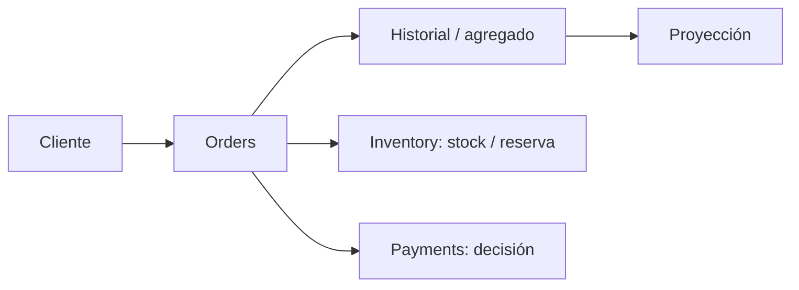

# P07 — Advanced Orders Platform: incidente de consistencia
**CORE · O7.** Checkpoint independiente con un defecto deliberado. Prerrequisito: comprender Event Sourcing, CQRS y Saga (P04). No necesitas Azure ni el mesh de P06.

## 1. El caso de negocio
El equipo comercial comunica una incidencia: algunos pedidos cancelados continúan reduciendo las existencias disponibles para otros clientes. En Orders aparecen como CANCELLED. Inventory informa de menos unidades vendibles. La aplicación responde, pero una invariante de negocio parece incumplirse. No conocemos todavía la causa.

Eres parte del equipo responsable de investigar y corregir la incidencia. Tu misión es reproducir el problema, reunir evidencias, diseñar una corrección, implementarla en Java y demostrar que no se rompe el camino exitoso. No se acepta modificar el verificador ni editar tablas para ocultar la discrepancia.


Pregúntate qué representa cada dato, quién es su propietario y qué garantía debería existir entre un estado cancelado y las reservas que lo afectan. La proyección puede estar desactualizada, una operación remota puede fallar o un efecto puede repetirse. No elijas una explicación antes de observar evidencia.

### Archivos y herramientas disponibles
- `services/orders/src/main/java/com/advancedorders/orders/state/OrderStateController.java`: comandos, historial, reconstrucción, proyección y coordinación.
- `services/inventory/src/main/java/com/advancedorders/inventory/state/InventoryStateController.java`: stock, reserva y liberación.
- `services/payments/src/main/java/com/advancedorders/payments/state/PaymentStateController.java`: decisión de pago simulada.
- `labs/p04-state/schema.sql`: tablas y restricciones de los tres servicios.
- `scripts/verify-p07.sh`: reproducción y aceptación final.
- `labs/p07-incident/ADR-template.md`: documento de decisión.

## 2. Reproduce y formula hipótesis
Usa tu sandbox propio. Si conservas un volumen P04 con suficiente stock, no hace falta eliminarlo. Guarda evidencias previas antes de cualquier reset. El verificador exige al menos 4 unidades disponibles de SKU-001. En un entorno nuevo hay 42. No reutilices un pedido anterior para reproducir un caso nuevo.

```bash
make p05-down
make p03-down
make p04-down
make p04-up
make verify
bash scripts/verify-p07.sh
echo "exit=$?"
```
La aplicación base debe funcionar. El verificador imprime un ID de incidente, stock antes y después, historial de eventos y un mensaje de discrepancia; el defecto esperado termina con código 42. Una excepción SQL, un error de arranque o un código distinto no demuestra el incidente. Guarda la salida real. El propio experimento puede dejar una reserva sin compensar; no repitas innecesariamente.

Anota dos hipótesis distintas y qué dato las confirmaría o descartaría. Por ejemplo: un modelo de lectura desactualizado, una discrepancia entre estado y efecto remoto, una repetición de operación o un contrato interpretado de forma incorrecta. Distingue síntoma, hipótesis y causa probada.

## 3. Investiga mediante evidencias
Sustituye ID por el valor que imprimió el verificador (incluido el sufijo -fail). Consulta los servicios:
```bash
BASE=http://127.0.0.1:8080/api
OS="$BASE/orders/training/state"
IS="$BASE/inventory/training/state"
ID='incident-REEMPLAZAR-fail'
curl -fsS "$OS/$ID/events"
curl -fsS "$OS/$ID/aggregate"
curl -i "$OS/$ID/query"
curl -fsS -X POST "$OS/$ID/project"
curl -fsS "$OS/$ID/query"
curl -fsS "$IS/stock/SKU-001"
C=(docker compose -f docker-compose.yml -f compose.state.yml --profile extended)
"${C[@]}" logs --tail=80 orders inventory payments
```
No confundir el catálogo estático de preview con el stock persistente P04. Si query devuelve 404, no significa que el pedido no exista. Proyecta y compara de nuevo. Registra las versiones y el estado de cada representación.

Si necesitas inspeccionar la persistencia, usa consultas de solo lectura dentro de tu sandbox. Sustituye el ID en la consulta por el valor exacto observado (alfanumérico y guiones):
```bash
"${C[@]}" exec -T postgres psql -U lab -d advms -c "SELECT order_id,version,kind FROM orders.event WHERE order_id='$ID' ORDER BY version;"
"${C[@]}" exec -T postgres psql -U lab -d advms -c "SELECT order_id,sku,quantity,status FROM inventory.reservation WHERE order_id='$ID';"
"${C[@]}" exec -T postgres psql -U lab -d advms -c "SELECT order_id,approved FROM payments.decision WHERE order_id='$ID';"
```
Correlaciona los resultados por orderId. No ejecutar UPDATE, DELETE ni modificar el historial. Estas consultas de diagnóstico no justifican que Orders acceda directamente a las tablas de otro servicio en producción.

Localiza el flujo de código correspondiente al comportamiento observado. Identifica qué debería cumplirse antes de registrar cada hecho y qué ocurre ante respuesta inesperada o fallo HTTP. Puedes consultar el modelo de P04, pero justifica tu conclusión con los datos del incidente. Recoge al menos dos evidencias independientes, una de ellas del participante.

## 4. Diseña e implementa la corrección
Antes de editar, describe el comportamiento esperado en tres escenarios: éxito, rechazo de pago y fallo de comunicación. Decide dónde corregir el código para mantener la responsabilidad de cada servicio. Conserva la idempotencia y no registres confirmaciones sin evidencia de su operación.

Implementa el cambio en Java. Añade una prueba propia que detecte la regresión (por ejemplo, verificar una invariante de stock/reserva o una transición tras un resultado remoto). No alteres verify-p07.sh ni las aserciones existentes para obtener un PASS. Reconstruye el servicio modificado:
```bash
"${C[@]}" up -d --build --wait --no-deps orders
make test
bash scripts/verify-p07.sh
```
Si tu corrección pertenece a otro servicio, reconstruye ese servicio. Espera PASS incident regression and successful order. El verificador crea pedidos nuevos, comprueba restauración de stock en cancelación, estado terminal idempotente y pedido exitoso. El éxito consume stock; calcula respecto al valor inicial de cada prueba.

Comprueba que el cambio de código no repara por sí solo pedidos históricos afectados. Diseña un procedimiento de reconciliación controlada: identificar discrepancias, verificar efecto real, aplicar una operación idempotente autorizada y registrar la corrección de acuerdo con el modelo del dominio. No ejecutar ese procedimiento sobre datos reales ni reescribir eventos a ciegas.

## 5. Cierra la investigación
Completa [ADR-template](ADR-template.md) y [EVIDENCE](EVIDENCE.md). Presenta el recorrido hipótesis → evidencia → causa → corrección → prueba. Explica la alternativa descartada y qué garantías faltan en producción (persistencia, coordinación entre réplicas, recuperación y observabilidad).

```bash
make p04-down
```
El volumen se conserva. Guarda diff, test y resultados antes/después. Si necesitas reset, consulta SUPPORT y confirma que es tu sandbox. El instructor dispone de pistas progresivas y de una solución privada, no la utilices antes de tu intento.

[SUPPORT](SUPPORT.md) · [STRETCH](STRETCH.md)
